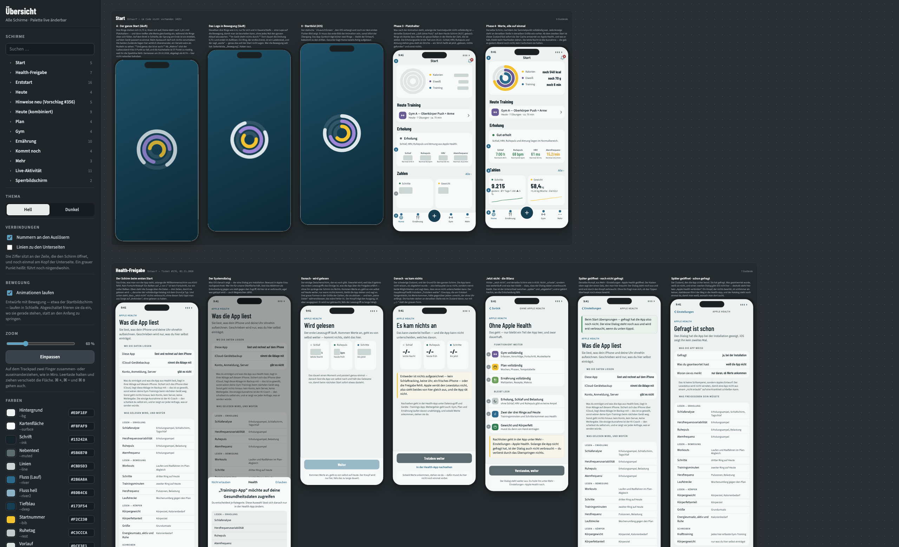

# 📐 Entwurfsboard

> Alle Schirme einer App als Gerätemodelle auf einer Fläche — mit Baum,
> Suche und Linien von der auslösenden Zeile zum Unterschirm.
> Ein Figma-Ersatz, der in Git liegt.




## Warum

Figma macht auf dem kostenlosen Tarif bei 20 Werkzeugaufrufen im Monat
dicht. Hier gibt es keine Grenze.

Der eigentliche Grund ist aber ein anderer: **Die Entwürfe sind Code.**
Sie liegen in Git, also ist der Unterschied zweier Stände lesbar. Ein
Agent kann sie lesen, und er kann sie schreiben. Ein Schirm, der sich
ändert, erzeugt einen Diff, über den man reden kann — kein stilles
Verschieben in einer Datei, die nur einem Werkzeug gehört.

Und das Entscheidende ist ohnehin nicht die Bildergalerie, sondern das
Verfahren drumherum:

- Ein Schirm wird **gezeichnet, bevor er gebaut wird.**
- Die Prüfung läuft **vor jedem Commit.**
- Der Entwurf wird **im selben Zug nachgezogen wie der Code** — in beide
  Richtungen. Ist die gebaute Fassung besser als der Entwurf, wandert
  die Verbesserung ins Board, statt dort die schlechtere stehen zu
  lassen.

Ohne diese drei Regeln ist das Board nach zwei Wochen eine hübsche Lüge.
Deshalb kommt der Textbaustein für die `CLAUDE.md` des benutzenden
Projekts mit — samt Begründungen, weil eine Regel ohne Grund nicht
befolgt wird.

## Stand: der Code ist noch nicht hier

Das Werkzeug läuft seit Oktober 2026 in einem privaten Projekt und wird
gerade herausgelöst. Dieses Repo ist **angelegt, bevor der Code da ist**,
damit Entwurf und Ideen von Anfang an öffentlich nachvollziehbar sind.

Was schon steht:

| Datei | Was |
|---|---|
| [`IDEEN.md`](IDEEN.md) | wohin das läuft, und was dafür entschieden werden muss |
| `bilder/board.png` | wie es heute aussieht |

**Das Bild stammt aus dem Projekt, aus dem das Werkzeug kommt.** Jede
Zahl darauf ist erfunden — das ist dort eine Regel, nicht ein Zufall:
Wer einen Schirm baut, liest das Board und schreibt die Zahlen ab, und
eine echte Zahl landet darüber in Testdaten und Kommentaren.

## Was in v1.0.0 kommt

**Nur der Motor.** Keine Bausteinbibliothek.

| Datei | Was |
|---|---|
| `motor/board.js` | Fläche, Zoom, Baum, Suche, Verbindungslinien, Farbwähler |
| `motor/bauen.mjs` | bündelt alles zu einer einzelnen HTML-Datei zum Verschicken |
| `motor/pruefen.mjs` | die Prüfungen, die vor dem Commit laufen |
| `motor/geruest.html` | Seitenleiste und Fläche |
| `motor/rahmen.js` | Geräterahmen, Navigations- und Tableiste |
| `motor/rahmen.css` | die Regeln dazu |
| `serve.py` | ein Server, der nicht bei der ersten offenen Verbindung stehenbleibt |
| `beispiel/` | zwei Schirme, an denen man sieht, wie es geht |
| `CLAUDE-baustein.md` | zum Einkleben in die `CLAUDE.md` des Projekts |

Warum nur der Motor: Was generisch *aussieht*, ist es oft nicht. Eine
Bausteinbibliothek, die aus einem einzigen Projekt herausgeschnitten
wird, trägt dessen Annahmen mit, ohne sie zu nennen. Bausteine wandern
später einzeln ein — aus Projekten, in denen sie sich bewährt haben.
Zwei Projekte sind ein Beleg, eins ist eine Vermutung.

**Und derselbe Satz gilt gegen dieses Repo:** Der herausgelöste Motor
wird an einem Beispiel aus zwei Schirmen geprüft, nicht an einem
vollständigen Projekt. Die ersten Lücken tauchen beim ersten echten
Einsatz auf. Das steht hier, damit es niemanden überrascht.

## Wie man es benutzen wird

```bash
git submodule add https://github.com/Burgerlein/Entwurfsboard.git docs/screens/.entwurfsboard
git -C docs/screens/.entwurfsboard checkout v1.0.0
```

Das Submodul gehört diesem Repo — **darin wird nichts geändert.** Alles,
was dem Projekt gehört, liegt daneben:

```
projekt/docs/screens/
├── .entwurfsboard/   ← Submodul, auf einem Tag festgenagelt
├── board.config.js   ← Palette, Reiter, Schriften, Symbole, Prüfungen
├── index.html        ← zehn Zeilen: lädt Config und Motor
├── tokens.css        ← Radien, Abstände, Schatten
├── bausteine.js      ← die eigenen Bausteine
├── registry.js       ← welche Schirme gezeigt werden, in welcher Reihenfolge
└── screens/*.js      ← ein Modul je Schirm
```

Ein Schirm sieht so aus:

```js
export default {
  id: 'liste',
  tab: 'Start',
  title: 'Übersicht',
  planstand: 'durchgeplant',
  variants: [{
    id: 'gefuellt',
    label: 'Mit Inhalt',
    note: 'Warum der Schirm so aussieht — der Platz für die Entscheidung.',
    render: () => '…HTML…',
  }],
};
```

### Die Vertragsfläche

Ein benutzendes Projekt hängt an sechs Dingen. Ändert sich eins davon,
steigt die MAJOR-Version — nicht nur bei der Config:

1. `board.config.js` — Form und Bedeutung jedes Eintrags
2. die Schirm-Objektform (`id`, `parent`, `tab`, `title`, `source`,
   `planstand`, `variants[]`)
3. die Attribute im Markup (`data-opens`, `data-tab`, `data-dead`) und
   die Klasse `flat`
4. die Klassennamen, die der Motor erzeugt und erwartet
5. die Element-IDs im Gerüst
6. die Form von `registry.js`

## Warum nicht einfach Storybook?

Storybook zeigt **Bausteine**, einen nach dem anderen. Hier geht es um
die **Landschaft**: welcher Schirm führt wohin, was fehlt noch, welcher
Zustand ist nicht entworfen. Die Linie von der angetippten Zeile zum
Unterschirm ist der Punkt — nicht die Zeile für sich.

## Lizenz

MIT. Siehe [`LICENSE`](LICENSE).
